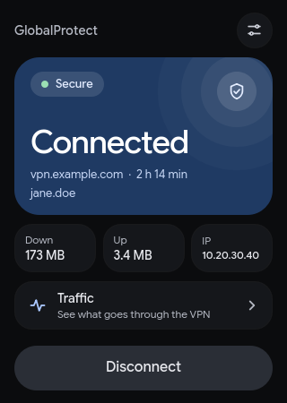
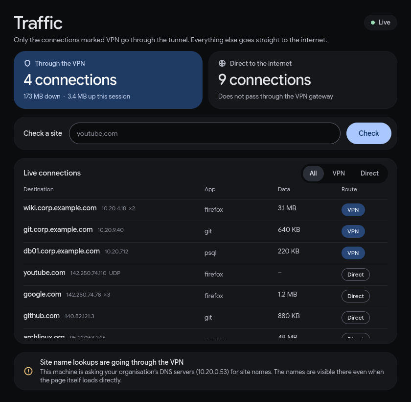
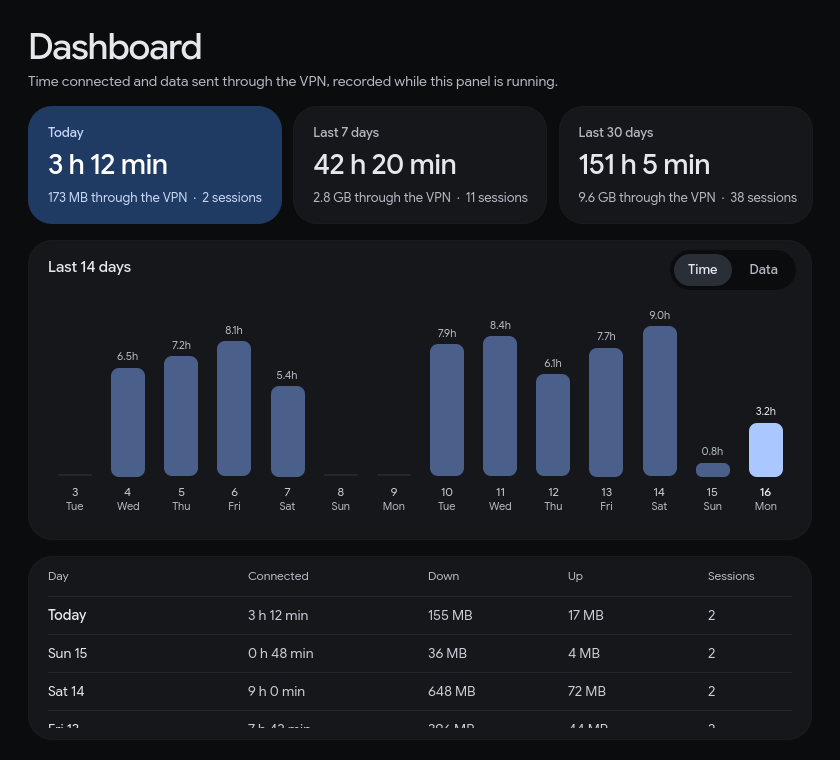

# omarchy-gp

[](LICENSE)

A small, modern GlobalProtect VPN client panel for Linux: a GUI for Omarchy and
Arch Linux on Hyprland, with a waybar item. It connects to Palo Alto
GlobalProtect portals through openconnect, so the official client is not
needed.

<p>
  
  
</p>

- One-click connect and disconnect
- Stays connected: reconnects after a drop and connects again at login
- Status, gateway, IP address and data counters
- A traffic window that shows which connections go through the VPN and which
  go straight to the internet, with a "check a site" box
- A dashboard with time connected and data used per day
- An account window for adding or changing the portal, username and password

It can connect in two ways:

- **Built-in engine (recommended):** uses `openconnect`. No official client
  needed, one-click connect, password kept in your system keyring. Works with
  portals that use a username and password.
- **Official client:** if the official GlobalProtect client is installed and
  the built-in engine is not set up, the panel shows its status and can
  disconnect it. Connecting through it is unreliable; use its own window.

## Requirements

- `pyside6`, `openconnect` and `vpnc` (`sudo pacman -S pyside6 openconnect vpnc`)
- `libsecret` and a running keyring such as `gnome-keyring` (to remember the
  password)
- `iproute2` (`ip`, `ss`) and `procps-ng` (`pgrep`), present on any Arch install
- Optional: Hyprland (panel docking, hiding the official window), `libnotify`
  (drop alerts), `systemd-resolved` (DNS note in the traffic window)

## Install

```sh
git clone https://github.com/Dagmawi-M/omarchy-gp.git
cd omarchy-gp
./install.sh
sudo ./setup-engine.sh
```

`install.sh` copies the app to `~/.local/share/omarchy-gp` and adds the
`omarchy-gp` command to `~/.local/bin`; it needs no root.

`setup-engine.sh` is the one step that needs `sudo`. It installs a small root
helper (`/usr/local/libexec/omarchy-gp-helper`) that can only bring the VPN
tunnel up or down, and lets your user run that helper without a password
prompt. Your VPN password never reaches the helper.

To remove everything: `./uninstall.sh` and `sudo ./setup-engine.sh --remove`.

## Use

| Command | What it does |
|---|---|
| `omarchy-gp` | Show or hide the panel |
| `omarchy-gp start` | Start in the background without showing the panel |
| `omarchy-gp connect` | Connect with the saved account |
| `omarchy-gp disconnect` | Disconnect |
| `omarchy-gp traffic` | Open the traffic window |
| `omarchy-gp dashboard` | Open the usage dashboard |
| `omarchy-gp status` | Print JSON for waybar |
| `omarchy-gp doctor` | Check that everything needed is in place |

First time: open the settings button (top right of the panel), choose
**Account**, and enter your portal, username and password. The password is
stored in your system keyring. After that, **Connect** is one click and never
asks you to authenticate.

Esc hides a window. The panel keeps running in the background so it reopens
instantly; choose **Quit** in settings to stop it.

## Staying connected

Once you have connected, the panel remembers that you want the VPN up. It
reconnects by itself if the tunnel drops, and connects again when you log in
(the installer adds a background autostart entry). Pressing **Disconnect**
turns that off until you next connect.

To stop it starting at login, delete `~/.config/autostart/omarchy-gp.desktop`.

## Dashboard



Time connected and data through the VPN, per day. It is recorded only while
the panel is running, and stored in `~/.local/state/omarchy-gp/history.json`.

## Waybar

Add a module to `~/.config/waybar/config.jsonc` and list it in a `modules-*`
array:

```jsonc
"custom/omarchy-gp": {
  "exec": "omarchy-gp status",
  "return-type": "json",
  "interval": 5,
  "format": "{icon}",
  "format-icons": { "connected": "󰦝", "disconnected": "󰦞" },
  "on-click": "omarchy-gp"
}
```

Optional styling in `style.css`:

```css
#custom-omarchy-gp.disconnected { opacity: 0.5; }
```

## Limits

- Web (SAML) logins and one-time codes are not handled. Use **Open official
  client** in settings for those.
- The traffic window names a site only when the name is already in your
  machine's DNS cache. It never looks up public addresses itself, because
  those lookups could be sent to your organisation's DNS servers. It shows
  which sites are contacted, not what you do on them.
- App names are only shown for your own processes.

## Troubleshooting

Run `omarchy-gp doctor` first. It lists what is in place and what is missing.

- **The button says "Finish setup":** the root helper is missing or older than
  this version. Press it and approve once.
- **"Sign in once in Settings, Account":** no password is saved yet, or your
  keyring is locked.
- **"Sign-in was rejected":** check the username and password in **Account**.
- **Connected, but internal sites do not load:** your organisation may require
  the official client's device check. Check the engine log at
  `/run/omarchy-gp-openconnect.log`.

## Updating

```sh
cd omarchy-gp
git pull
./install.sh
```

If the panel then shows **Finish setup**, the root helper changed in that
version; approve it once.

## Contributing

Bug reports and pull requests are welcome. See [CONTRIBUTING.md](CONTRIBUTING.md),
and [SECURITY.md](SECURITY.md) for reporting a vulnerability privately.

## How it was made

omarchy-gp was designed, directed and tested by me, with the code written using [Claude Code](https://claude.com/claude-code) (Anthropic) as an AI coding assistant.

## Licence

MIT. See [LICENSE](LICENSE).

This project is not affiliated with Palo Alto Networks. GlobalProtect is their
trademark.
